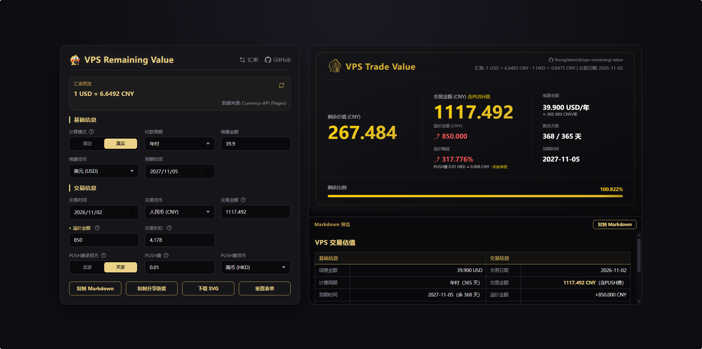

<div align="center">

# VPS Remaining Value (VPS 剩余价值计算器)

一个用于计算各类订阅服务剩余价值的 Web 工具，支持动态汇率转换，并可生成 SVG 分享图

**URL 即数据，SVG 按需生成；无数据库保存估值记录，无硬盘存储分享图片**



</div>

---

## 预览

### SVG

|  |  |  |  |  |
|-----------------------|-----------------------|---------------------------|---------------------------|---------------------------|

### [Markdown文本](./resource/preview.md)

---

## 设计理念

### URL 即数据：估值状态由链接携带

传统的分享系统通常需要先将数据保存到数据库，再生成一个用于查询记录的分享链接

VPS Remaining Value 采用不同的设计：将估值参数直接编码到 URL 中

接收者打开分享链接时，服务端从 URL 解码出估值参数，前端据此恢复对应的估值状态

- 不需要数据库保存每一笔估值记录
- 不需要为每次估值生成数据库记录 ID
- 不需要维护估值记录的存储、查询与清理
- 分享链接本身就包含恢复估值所需的数据

**数据由链接携带，而不是由数据库保管**

### SVG 按需生成：不存储图片文件

SVG 分享图不需要预先生成，也不需要作为图片文件存储在服务器上

当客户端请求 SVG 分享链接时，服务端解析其中的估值参数，根据数据动态构建 SVG 内容，并直接以 `image/svg+xml` 响应返回

- 不需要将生成的 SVG 写入服务器硬盘
- 不需要为每张分享图分配文件名或存储路径
- 不需要维护图片文件索引
- 不需要清理过期的分享图片

**请求时生成，生成后直接返回；不存储 SVG 图片文件**

---

## 分享链接压缩：基于 Schema 的位域紧凑二进制序列化

- 当前版本：V2 编码（`/v2/<base64>`）
- 旧版兼容：V1 链接（`/vrv<base64>`）仍可正常解析

V1/V2 都属于面向固定业务 Schema 的紧凑二进制序列化（Schema-driven Binary Serialization），而不是通用压缩：

- **共同特征**：字段、类型与位位置预先约定；默认值不写入数据；Base64URL 传输
- **V2 增量**：位域压缩与可推导字段复用
- **明确边界**：不是 Delta 差分编码，也不是 LZ / Huffman 等通用压缩算法

V2 与 V1 的差异：

- **Bit-field encoding**：`cm` / `eom` / `ps` 只使用存在位表示 `fixed` / `eom` / `buyer`，不再单独占用 1 字节
- **Bit packing**：`rc` / `tc` 合并为 1 字节（低 4 位 rc、高 4 位 tc），`pc` 使用 1 字节低 4 位
- **Derived-field elision**：`pc` 与 `rc` 相同时，`per` 复用 `er`，不再单独存储，解码时按同一条件回填
- **版本标识**：通过链接路径区分，不额外占用参数字节

以下数据由与前端相同的编码函数逐场景实际生成：

- 付款周期：365 天
- 到期日期：2027-11-05
- 交易日期：2026-11-03

未列出的字段取默认值：续费货币 USD、交易货币 CNY、PUSH 费货币 CNY、计算模式 real、起始日推算 exact、PUSH 费承担方 seller

| 场景             | 实际参数（覆盖项）                                           | V1 编码                                            | V1 长度 | V2 编码                                           | V2 长度 | 缩减 |
| ---------------- | ------------------------------------------------------------ | -------------------------------------------------- | ------- | ------------------------------------------------- | ------- | ---- |
| 最简（无汇率）   | 续费金额 50                                                  | `ADVCSAAAAW1Sh1EY`                                 | 16      | `ADVCSAAAAW1Sh1EY`                                | 16      | 0    |
| 含汇率           | 续费金额 50、续费汇率 7.12                                   | `CDVCSAAAAW1Sh1EYQOPXCg`                           | 22      | `CDVCSAAAAW1Sh1EYQOPXCg`                          | 22      | 0    |
| 交易金额         | 续费金额 50、续费汇率 7.12、交易金额 850.5                   | `CTVCSAAAAW1Sh1EYRFSgAEDj1wo`                      | 27      | `CTVCSAAAAW1Sh1EYRFSgAEDj1wo`                     | 27      | 0    |
| 溢价金额         | 续费金额 50、续费汇率 7.12、溢价金额 850.5                   | `CLVCSAAAAW1Sh1EYRFSgAEDj1wo`                      | 27      | `CLVCSAAAAW1Sh1EYRFSgAEDj1wo`                     | 27      | 0    |
| 非默认币种       | 续费金额 50、续费货币 EUR、交易货币 JPY、续费汇率 150.1234   | `CjdCSAAABQFtUodRGAlDFh-X`                         | 24      | `CDdCSAAAlQFtUodRGEMWH5c`                         | 23      | 1    |
| fixed + eom      | 续费金额 50、计算模式 fixed、起始日推算 eom、续费汇率 7.12   | `DD1CSAAAAW0CUodRGAJA49cK`                         | 24      | `DD1CSAAAAW1Sh1EYQOPXCg`                          | 22      | 2    |
| PUSH（买家承担） | 续费金额 50、续费汇率 7.12、PUSH 费 10、承担方买家、PUSH 费货币 USD、PUSH 汇率 6.79 | `eDUAA0JIAAABbVKHURhA49cKQSAAAAIPQNlHrg`           | 38      | `eDUAAUJIAAABbVKHURhA49cKQSAAAA8`                 | 31      | 7    |
| PUSH（卖家承担） | 续费金额 50、续费汇率 7.12、PUSH 费 10、PUSH 费货币 USD、PUSH 汇率 6.79 | `WDUAA0JIAAABbVKHURhA49cKQSAAAA9A2Ueu`             | 36      | `WDUAAUJIAAABbVKHURhA49cKQSAAAA8`                 | 31      | 5    |
| PUSH 汇率复用    | 续费金额 50、续费货币 HKD、交易货币 JPY、付款周期 30、续费汇率 0.85、PUSH 费 10、承担方买家、PUSH 费货币 HKD、PUSH 汇率 0.85 | `ejcAA0JIAAAHAB5Sh1EYCT9ZmZpBIAAAAgc_WZma`         | 40      | `eDcAAUJIAACXAB5Sh1EYP1mZmkEgAAAH`                | 32      | 8    |
| 高精度 PUSH 汇率 | 续费金额 39.9、溢价金额 850、续费汇率 6.6661、PUSH 费 1、承担方买家、PUSH 费货币 HKD、PUSH 汇率 0.8496155 | `eLWAA0IfmZoBbVKHURhEVIAAQNVQsT-AAAACBz_rMAzYVZcL` | 48      | `eLWAA0IfmZoBbVKHURhEVIAAQNVQsT-AAAAHP-swDNhVlws` | 47      | 1    |
| 全字段           | 续费金额 10、续费货币 EUR、交易货币 JPY、计算模式 fixed、交易金额 100、起始日推算 eom、续费汇率 150.1234、PUSH 费 2、承担方买家、PUSH 费货币 USD、PUSH 汇率 140.5 | `fz8AA0EgAAAFAW0CUodRGELIAAAJAkMWH5dAAAAAAg9DDIAA` | 48      | `fT8AA0EgAACVAW1Sh1EYQsgAAEMWH5dAAAAAD0MMgAA`     | 43      | 5    |

完整链接以 `http://localhost:45867` 为例，V1 前缀为 `/vrv`、V2 前缀为 `/v2/`，两者前缀长度相同，所以链接长度的差值等于 Base64 长度的差值：

| 场景             | V1 完整链接长度 | V2 完整链接长度 | 缩减 |
| ---------------- | --------------- | --------------- | ---- |
| 最简（无汇率）   | 42              | 42              | 0    |
| 含汇率           | 48              | 48              | 0    |
| 交易金额         | 53              | 53              | 0    |
| 溢价金额         | 53              | 53              | 0    |
| 非默认币种       | 50              | 49              | 1    |
| fixed + eom      | 50              | 48              | 2    |
| PUSH（买家承担） | 64              | 57              | 7    |
| PUSH（卖家承担） | 62              | 57              | 5    |
| PUSH 汇率复用    | 66              | 58              | 8    |
| 高精度 PUSH 汇率 | 74              | 73              | 1    |
| 全字段           | 74              | 69              | 5    |

没有使用默认值以外的 `cm` / `eom` / `ps` 或非默认币种时，V1 与 V2 长度相同；启用这些字段，或 PUSH 费货币与续费货币相同时，V2 才能体现编码长度优势，最多可缩短 8 个字符

~~忙活半天，没多大变化🤡~~

---

## 本地运行

```bash
npm install
npm run start
```

服务默认运行在 [http://localhost:45867](http://localhost:45867/)

---

## 环境变量

| 变量         | 必填 | 说明                                                         |
| ------------ | ---- | ------------------------------------------------------------ |
| `SECRET_KEY` | 是   | 签名密钥，用于请求令牌签发与校验                             |
| `TIMEZONE`   | 否   | 计算日期与日志所用时区，填写 IANA 时区名（如 `Asia/Shanghai`），不填默认 `Asia/Shanghai` |

---

## Docker 部署

### 本地构建

```bash
docker build -t vps-remaining-value:latest .

docker run -d \
  -p 45867:45867 \
  -e SECRET_KEY="YourCustomSecretKeyHere" \
  -e TIMEZONE=Asia/Shanghai \
  --restart always \
  --name vps-remaining-value \
  vps-remaining-value:latest
```

### 使用 GitHub Container Registry 镜像

```bash
docker run -d \
  -p 45867:45867 \
  -e SECRET_KEY="YourCustomSecretKeyHere" \
  -e TIMEZONE=Asia/Shanghai \
  --restart always \
  --name vps-remaining-value \
  ghcr.io/youngyannick/vps-remaining-value:latest
```