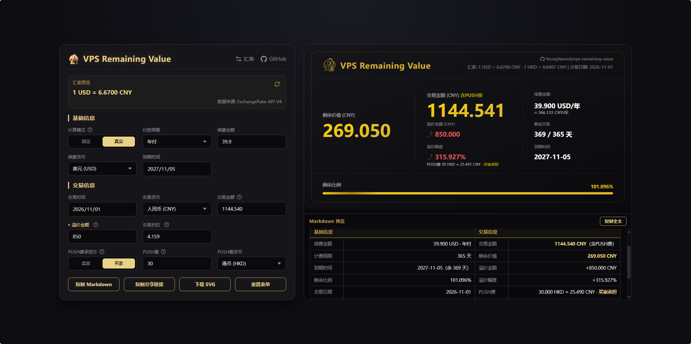

# VPS Remaining Value (VPS 剩余价值计算器)

一个用于计算 各类订阅服务剩余价值的 Web 工具，支持动态汇率转换并可生成 SVG 分享图



## SVG 预览

|  |  |  |
|-----------------------|-----------------------|---------------------------|

## 本地运行

```bash
npm install
npm run start
```

服务默认运行在 http://localhost:45867

## 环境变量

| 变量 | 必填 | 说明 |
| --- | --- | --- |
| `SECRET_KEY` | 是 | 签名密钥，用于请求令牌签发与校验 |
| `V6_API_KEY` | 否 | ExchangeRate-API V6 密钥，未配置时自动跳过该源 |
| `TZ_OFFSET` | 否 | 日期默认值所用时区偏移（小时），不填默认 `8`（北京时间） |

## Docker 部署

```bash
docker build -t vps-remaining-value:latest .
docker run -d -p 45867:45867 -e SECRET_KEY="YourCustomSecretKeyHere" -e V6_API_KEY="YourExchangeRateV6KeyHere" -e TZ_OFFSET=8 --restart always --name vps-remaining-value vps-remaining-value:latest
```

```bash
docker run -d -p 45867:45867 -e SECRET_KEY="YourCustomSecretKeyHere" -e V6_API_KEY="YourExchangeRateV6KeyHere" -e TZ_OFFSET=8 --restart always --name vps-remaining-value ghcr.io/youngyannick/vps-remaining-value:latest
```
